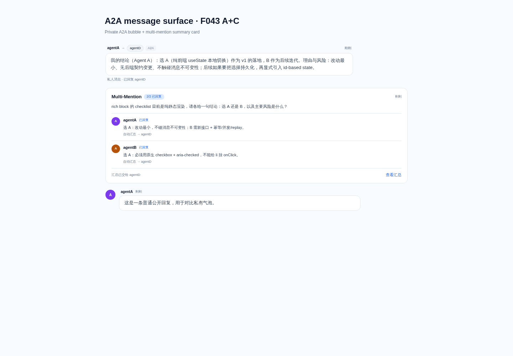
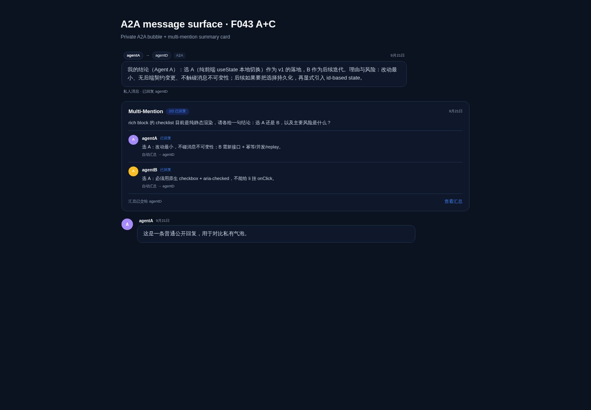
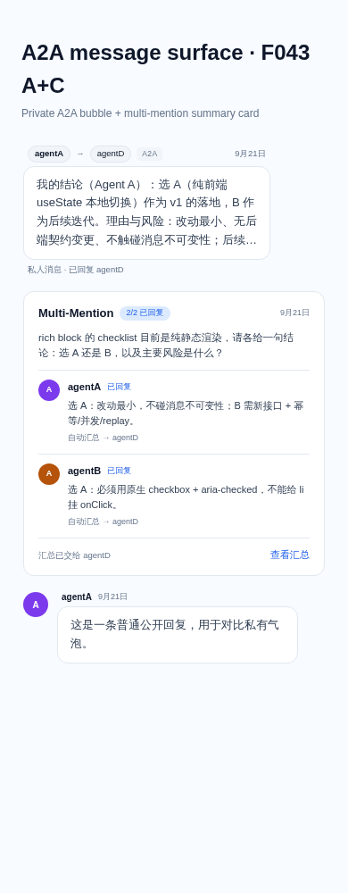

# F043: A2A parallel dispatch & post_message surface

> **Design status (2026-11-27).** 后端设计不再作为基线（在 architecture drift 上做的
> 缝补）；holistic 设计与 feature 拆分见
> [`docs/plans/0050-a2a-runtime-alignment.md`](../plans/0050-a2a-runtime-alignment.md)。
> **前端 AC-4 按 operator 2026-11-27 指示作为 F043 内容补做完成**：A（私有气泡）+
> C（multi-mention 汇总卡）。F043 的 live 行为继续作为 F044–F050 的回归要求；
> 不在后端补丁上继续扩展。
>
> **F050 status（2026-11-28）**：F043 后端设计 **superseded**；F044–F048 + F046b 已
> 承接其行为。前端 AC-4（私有气泡 + 汇总卡）已交付；真实 Hub 1440/390 光暗视觉验收
> 仍归 F050 AC-4b，不把 AC-4 标成 live complete。

## Why

operator 在 `a2a-测试` thread 做 multi-mention / post_message / 排队测试，暴露四个问题：

1. A/B/C 回答 multi-mention 后又各自 `post_message` 给 agent D；D 被额外唤醒多次，
   其中几条回复是"线程上下文为空"。
2. agent C 的回答声称"三家（A、B、我）均一致选 A"；按并行设计，C 不应看到 A/B 的回答。
3. `post_message` 在公开时间线里和普通 agent 回复长得一样，气泡语义不清楚。
4. agent D 持续运行两分钟期间，operator @agent C，C 被队列挡住，直到 D 结束才执行。

这些不是四个孤立 bug：Q2/Q4 共用同一个调度根因，Q1 是投递上下文根因，Q3 是消息表面设计问题。

## 用户结果

- multi-mention 的各目标从同一个触发快照开始，互相看不到本轮其他目标的回答。
- 单只 agent 的长任务不会阻塞其他 agent 的独立消息；队列面板只显示真正等待的投递。
- `post_message` 的目标能读到这条消息本身，不出现"无新消息"的空转回复。
- A2A 私有消息不再冒充公开回复：默认收成"投递回执行"或进入 multi-mention 汇总卡，
  需要时可展开正文。

## 根因（已定位，证据见报告）

- **Q2/Q4 调度**：`DaemonA2A.tick` 是 single-flight；`QueueProcessor.drain` 会 `await`
  `RunAgentTurn.dispatch` 的完整 turn。D 的两分钟 turn 占住 drain，C 的独立 entry 只能等。
  multi-mention 的多个 target 在 `processEntry` 里也是 `for ... await dispatch` 串行。
- **Q2 上下文**：`HistoryAssembler.loadHistory` 按每 agent 的 delivery cursor 取"之后"的消息；
  C 的 prompt 在 A/B 完成后才构建，A/B 的 response 对 C 可见（`visibleTo` 广播 response），
  所以 C 读到了 A/B 的结论。
- **Q1 空上下文**：`post_message` 会 enqueue `message_wake`；但 D 的 delivery cursor 已到 38，
  而 A/B/C 的 post_message 是 seq 19/23/25，低于 cursor，`loadHistory` 不会取到 →
  D 的 turn 看到空窗口，回复"无新消息"。
- **Q3 表面**：`post_message` 是 `lifecycle.kind=input` 的普通 agent 消息，前端按普通气泡渲染；
  没有收件人/A2A 语义，也没有和 multi-mention 汇总归组。

## 范围

- 调度：drain 在 provider handoff 后继续（不等完整 turn），或在 per-thread 内允许受控并发；
  multi-mention 的 target 并发 fan-out，tracker 继续按 (thread, agent) 保护同 agent 槽。
- 上下文：为每个 queue entry 固定触发消息快照（上界为触发 seq），并显式包含触发消息本身；
  不依赖目标 agent 的 delivery cursor 是否已越过它。
- `post_message`：把源消息作为目标的 exact input 投递；multi-mention target 向发起者
  重复 post_message 时直接拒绝（回答会自动汇总投递），不再额外唤醒。
- UI：A2A 私有消息的收敛设计（A：无头像私有气泡；C：multi-mention 汇总卡），
  Pencil 稿见 `docs/design/F043/`。

## 非目标

- 不引入 task/run 脚手架，不改 thread-first 语义。
- 不改变 multi-mention 的聚合协议与 timeout/partial 语义。
- 不改 queue cap（v1 仍是每 thread 每 kind 5 条；Clowder 的用户消息 cap 也是 5）。

## 验收

- [x] AC-1：multi-mention 三个 target 的 turn 实际并发启动；任一 target 的 prompt 不包含本轮
  其他 target 的 response（按触发 seq 快照）。
- [x] AC-2：agent A 长跑期间 @agent B，B 在 A 结束前开始执行；队列面板只在 B 真正等待时显示。
- [x] AC-3：post_message 唤醒的目标能在 prompt 中读到源消息；不再出现"无新消息"的空转回复。
- [ ] AC-4（code implemented; **live visual proof pending F050**）：A2A 私有消息按选定设计渲染（A：无头像私有气泡 + recipient pill + A2A 标记）；
  multi-mention burst 收进 C 汇总卡，不再散落成多个气泡。实现于
  `packages/superagentteam-web/src/components/chat/MessageList.tsx`；web 120 tests + build 绿。
  **live 视觉完成待 F050**：需带 topbar/sidebar/composer 的真实 Hub 截图（1440/390、光暗），
  当前不把 AC-4 标成 live complete。
  （设计已选定 A + C；前端实现待做。）
- [x] AC-5：daemon/web tests、typecheck、doc-index 绿；非作者 review。

## 风险

- handoff 式 drain 改变失败收敛路径：provider-phase 失败必须仍能 terminalize/restore，
  不能留下悬空 turn/credential；需要针对失败路径补回归。
- 并发 fan-out 会放大 provider 并发；沿用 worker pool capacity，必要时做每 thread 上限。
- 上下文快照必须兼容现有 replay/ack 语义；不能让 response placeholder 被错误 ack。

## 进展（2026-11-27）

- 完成 live 取证与 Clowder 对照，根因报告：
  `docs/reports/2026-11-27-a2a-parallel-investigation.md`。
- Clowder 深研后按 `route_parallel` / per-cat slot / trigger snapshot 适配：
  - `QueueProcessor.processEntry` 对同一 entry 的全部 target 并发 dispatch（`Promise.all`），
    不再 `for ... await` 串行；失败收敛仍按 target 独立处理。
  - `HistoryAssembler.loadHistory` 新增 `upToSeq` 触发快照与 `includeSourceMessageId`；
    `RunAgentTurn` 用 queue source message 作为本轮上下文上界，并显式包含源消息
    （post_message 目标不再读到空窗口）。
  - `DaemonA2A.tick` 从全局 single-flight 改为有界并发 drain（最多 8 个），
    per-(thread, agent) tracker 继续保证同 agent 不双启；长 turn 不再挡住其他 agent。
  - multi-mention 提问追加"回答自动汇总投递，不需要 post_message"；daemon 侧对
    target→发起者的重复 post_message 返回 `multi_mention_auto_delivery`，不创建消息/唤醒。
  - 测试：daemon 520 passed / 1 skipped（新增 history 快照、并发 fan-out、并发 drain、
    auto-delivery 拒绝、deleted trigger 守卫 5 条用例）。
- 设计：operator 选定 A（无头像）+ C；B 删除，C 的附注改为"自动汇总 → agentD"。
  Pencil 稿 `docs/design/F043/a2a-message-1440.png`。
- 复审：墨墨 approve `f3b0e567f`，再 approve delta `c6cacb2d2`（deleted trigger 守卫 +
  allSettled；CI 5/5）。
- 合入：PR #235 merged `f51d9f3c7`；live 3005/3014 已部署 `f51d9f3c7` 并重建 daemon dist。
- Live 验证（a2a-测试 thread）：
  - multi-mention：A/B/C 同一时刻启动，结束于 +2.82s / +3.00s / +3.66s（全部重叠）；
    没有额外的 A/B/C post_message 消息（auto-delivery 生效）。
  - 长 turn 排队：D 运行 60s（1795759685439 → 1795759748270）；C 的探针在 D 运行中发送
    （1795759693274），invocation 169ms 后启动并于 1795759696697 完成——未等 D 结束。
- 剩余：前端 A/C 实现；operator 验收。

### 2026-11-27 前端 AC-4 补做（operator 指示）

- A：A2A 私有消息渲染为无头像私有气泡；recipient pill + A2A 标记 + 展开全文；
  普通公开回复保持 nameplate。
- C：multi-mention 收进一张汇总卡（question + per-target rows + 状态 + 自动汇总目标），
  对应 response 行从主时间线隐藏，不再散落。
- 代码：`packages/superagentteam-web/src/components/chat/MessageList.tsx`、
  `packages/superagentteam-web/src/domains/chat/api.ts`、`src/styles/global.css`。
- 验证：web 120 tests / 25 files 全绿；`npm run build --workspace @superagentteam/web` 绿。
- 待 operator 视觉验收。

### 2026-11-27 review P1/P2（砚砚）

- **P1 已修**：daemon `post_message` 在写 agent message 时补 `extra.targetAgentIds`
  （同线程单 target、非 crossPost）；私有气泡在真实数据流可达，并顺手收窄了
  append→dispatch 间隙的可见性。回归：
  - `f018-r3-a-post-cross-post.test.ts` 断言 stored message extra；
  - `api-messages.test.ts` 断言 GET 序列化含 `extra.targetAgentIds`；
  - daemon 521 passed / 1 skipped；定向 45/45 + API 8/8。
- **P2 已披露**：以下截图是 **fixture 渲染验证**（无 topbar/sidebar/composer），
  不是真实 Hub 数据；真实栈 1440/390 光暗截图由 F050 AC-4b 补拍，当前不标 live complete。

> 截图说明：本组图为 fixture 渲染验证，不是真实 Hub 截图。

