# F037 thread-first full-feature E2E — detailed test report

## 1. 报告范围

本报告是 F037 的详细测试记录，面向 operator 验收。它回答三个问题：

1. 测了什么：thread-first 当前实现的主链、Hub 操作面和真实 provider 链路。
2. 怎么测的：隔离栈、真实 Kimi、真实 daemon/worker、mock provider、API/DB/SSE
   断言、浏览器操作和截图。
3. 结果如何：29 个明细用例全部通过；完整 36 项覆盖矩阵全通过；修复 1 个 P2
   移动端 Settings 缺口；1 个 P3 prompt 可读性问题挂账。

**代码坐标**

| 项 | 值 |
|---|---|
| 实现/E2E PR | #211，landed `2db3f3b79135ea13bfd9692c06b31ab5af1c3c5a` |
| reviewed HEAD | `e7b27af5b`（实质代码 `93997c049`） |
| 状态文档 PR | #212，landed `60ce12ce33155fdd15f794b42725c57763aa5892` |
| 当前开发分支 | `origin/superagentteam-work` @ `60ce12ce3` |
| 非作者 review | 墨墨 approve `e7b27af5b` |
| CI | PR #211 5/5；PR #212 5/5 |

## 2. 测试环境与隔离

| 项 | 值 |
|---|---|
| 代码基线 | `origin/superagentteam-work` @ `ce0ad54db` |
| 工作分支 | `feat/f037-thread-first-e2e` |
| worktree | `/home/ming/agent/codeteam-f037` |
| test 栈 | web `3007` / daemon `3016` |
| test data | `/home/ming/.superagentteam-f037-e2e/data` |
| 真实 provider | Kimi `kimi-coding` / `kimi-for-coding` |
| 浏览器 | Chromium via Playwright MCP；1440×900 / 390×844 |
| 正式栈边界 | 未写入正式入口/数据；只读取 accounts/catalog 确认 provider 配置；未读取/使用正式消息或会话数据 |
| 收尾 | 隔离栈 `end`，3007/3016 已释放；正式 3005/3014 未操作 |

**隔离数据**

- 三份测试 thread：
  - `thread:eca3fa2572a1a3817b41eb33013f53ff`（主 thread，后改名 `F037 Hub E2E Renamed`）
  - `thread:dce556d7b25e8f4899f1f61adf9e4b14`（跨 thread 目标）
  - `thread:19ebbc3b7ee605fdabce0bcd107280ab`（失败/重试用例）
- 测试 agent：`f037a` / `f037b` / `f037c`，以及临时创建的 `f037-agent-d-75bc`、
  `f037-agent-e-58cd`。
- 测试 account：Kimi 真实 account；临时 OpenAI 测试 account
  `f037-test-account-1a92`（fake key，已删除）和 `f037-bad-key-f5fd`（401 失败用例）。

## 3. 测试策略

| 层 | 手段 | 证明什么 |
|---|---|---|
| 后端契约 | 真实 daemon + 真实 pi worker + mock provider；API/DB/SSE 断言 | 状态机、队列、invocation/turn/attempt、A2A 工具链、取消/恢复、无 legacy 依赖 |
| Hub 操作面 | 隔离栈真实浏览器操作 + 截图 + DOM/API 断言 | 用户实际能创建、发送、看到、停止、重试、改名、设置、移动端导航 |
| 真实 provider | 隔离栈 + 真实 Kimi account | 真实模型回合、真实 A2A、真实跨 thread、真实 multi_mention、真实取消/重启 |

**判定口径**

- `pass`：本轮实际执行并观察到预期结果。
- `pass (auto)`：由 daemon/web 全量测试覆盖，本轮套件通过；不是本轮手工重复。
- 截图只证明界面可见结果，不替代 DB/API 断言；每个关键 UI 用例都同时记录状态或数据。

## 4. 测试用例与执行结果

### 4.1 后端 A2A 契约

| ID | 前置 | 操作步骤 | 期望 | 实际 | 结果 | 证据 |
|---|---|---|---|---|---|---|
| B-01 | 隔离 data dir、test 栈 | 启动 3007/3016；`runtime status --check-write`；打开 `/api/session` | running；write path ok；session 200 | 一致；web/daemon health true | pass | 命令输出；`f037-hub-empty-1440.png` |
| B-02 | 合法/非法 projectPath | 创建 thread；相对/不存在/文件路径；重复 idempotencyKey | 合法 201；非法 422；replay 幂等 | 与 API 测试一致 | pass (auto) | `api-threads.test.ts` |
| B-03 | 一个 agent、真实 Kimi | operator 发消息 → 等回复 | Invocation/Turn/attempt completed；回复落库 | `F037_HUB_OK`；parent/turn completed | pass | `f037-reply-1440.png`；DB |
| B-04 | 两 agent、同 thread | A 调 `post_message` 给 B；B 回复 | 两次 invocation 按 queue 唤醒；B 回复同 thread | `A2A_FROM_A` → B 回复；A toolEvents 含 `post_message` | pass | `f037-reply-1440.png`；`f037-fullstack-e2e.test.ts` |
| B-05 | 两个 thread | thread1 A 调 `cross_post_message` 到 thread2；B 回复并回帖 | 目标 thread 收到并唤醒；双向 provenance | `CROSS_FROM_THREAD1` + `CROSS_ACK_FROM_THREAD2` | pass | `f037-cross-thread-1440.png` |
| B-06 | 三个 agent | A 调 `multi_mention` 给 B+C，`callbackTo=A` | fan-out；aggregate；callback A | `MULTI_B_OK` / `MULTI_C_OK`；aggregate + A 汇总 | pass | `f037-multi-mention-1440.png` |
| B-07 | 运行中 agent | 发长任务；点击停止 | parent/turn/attempt canceled；worker 释放；queue 不 restore | `已取消`；DB `operator_canceled`；live 清空 | pass | `f037-cancel-1440.png`；DB |
| B-08 | 已有历史数据 | 重启动隔离栈；检查 running；再发新消息 | 不重复 terminal；历史保留；新回合可执行 | 25 messages / 11 invocations 保留；0 running；`RESTART_OK` | pass | 命令输出；DB |
| B-09 | 无效 account key | 发消息；等待失败；点重试 | 401 终态 failed；可手动重试；显示可读错误 | `provider_error`；重试显示“已重新排队” | pass | 失败气泡 + 重试状态 |
| B-10 | 任意 thread | 订阅 `/api/events`；发消息 | change + text/done stream；终态落库 | 3 change + 3 stream；`SSE_OK` | pass | `/api/events` 原始流 |

### 4.2 Hub 操作面

| ID | 前置 | 操作步骤 | 期望 | 实际 | 结果 | 证据 |
|---|---|---|---|---|---|---|
| H-01 | 空 Hub | 新建 thread；发消息；观察时间线 | thread 出现在 sidebar；消息/回复可见；无 console error | 创建成功；回复可见 | pass | `f037-hub-empty-1440.png`、`f037-reply-1440.png` |
| H-02 | 已有 thread、后台回复 | 在首页等待后台回复；打开 thread；reload | unread=1；打开清零；reload 保持 0 | 一致 | pass | sidebar badge；`/api/threads` |
| H-03 | 已有 thread | header 重命名；空标题；reload | header/sidebar 同步；空标题拒绝；titleSource=user | 同步；保存按钮禁用；reload 保留 | pass | header/sidebar；DB |
| H-04 | failed invocation | 点击失败气泡“重试” | 显示“已重新排队”；不重复提交 | 显示重试状态；新 attempt 失败气泡 | pass | 失败/重试气泡 |
| H-05 | 运行中 agent | 点击 LivePill“停止” | live 清空；消息“已取消” | 一致 | pass | `f037-cancel-1440.png` |
| H-06 | Settings → Agents | 新建 Agent D；编辑 account/model | 不重启动；catalog 落盘；model 联动 | 创建成功；catalog 更新；model 跟随 account | pass | Settings 截图；catalog |
| H-07 | Settings → Accounts | 新建账号；绑定删除；解绑删除 | secret 不回显；绑定删除 409；解绑可删 | 一致；`accounts.json` 无 key；credentials 0600 | pass | Settings 截图；文件检查 |
| H-08 | 390×844 | 打开 sidebar；进入 Settings；返回对话 | 有 Settings 入口；有返回入口 | 修复后一致；桌面不重复入口 | pass | `f037-mobile-nav-390.png`、`f037-settings-390-fixed2.png`；修复前 `...-before.png` |
| H-09 | 有 tool 调用的回复 | 展开 execution record；展开工具行 | 显示 thinking/tool/args/result | 显示 `create_rich_block` 与 args/result | pass | `f037-rich-block-1440.png` |
| H-10 | agent 调富块 | 让 A 创建 card；刷新 | 最终回复下渲染 card；刷新仍在 | 渲染 “F037 Rich Card”；DB 有 `f037-card` | pass | `f037-rich-block-1440.png` |
| H-11 | 有 A2A/跨 thread 消息 | 观察消息 surface | agent 气泡、operator 头像、A2A 收件人、跨 thread badge | 全部可见 | pass | `f037-cross-thread-1440.png`、`f037-multi-mention-1440.png` |
| H-12 | 1440/390 | light/dark；检查横向滚动；侧栏抽屉 | 无横向滚动；composer 可用 | `scrollWidth=390`；抽屉可开合；dark 可读 | pass | `f037-thread-390-light.png`、`f037-thread-390-dark.png`、`f037-thread-1440-dark.png` |
| H-13 | 401/relogin | 触发深链接回归 | 401 → relogin → 回原 thread；恶意跳转拒绝 | 由 web/daemon 自动化覆盖；本地 dev auto-login 不产生 401 | pass (auto) | `relogin-page.test.tsx` / `return-to.test.ts` |

### 4.3 真实 provider 链路

| ID | 前置 | 操作步骤 | 期望 | 实际 | 结果 | 证据 |
|---|---|---|---|---|---|---|
| P-01 | 真实 Kimi account | 单 agent 发 “Reply with exactly F037_HUB_OK” | 真实回复落库；provider/model 正确 | `F037_HUB_OK`；`kimi-coding` / `kimi-for-coding` | pass | `f037-reply-1440.png`；DB |
| P-02 | 同 thread A/B | A 调 `post_message` 给 B；B 回复 | A/B 两次 invocation 完成；B 回复可见 | `A2A_FROM_A` + B 回复；A toolEvents `post_message` | pass | thread 消息；DB |
| P-03 | thread1/thread2 | A 跨帖到 thread2；B 回帖 thread1 | 双向；provenance 正确 | `CROSS_FROM_THREAD1` / `CROSS_ACK_FROM_THREAD2` | pass | `f037-cross-thread-1440.png` |
| P-04 | A/B/C | A 调 `multi_mention` 给 B+C | B/C 回答；aggregate；A 回调 | `MULTI_B_OK` / `MULTI_C_OK`；A 汇总 | pass | `f037-multi-mention-1440.png` |
| P-05 | 长任务 | provider 在飞时停止 | turn/attempt canceled；worker 释放 | `operator_canceled`；live 清空 | pass | `f037-stop-button-1440.png`、`f037-cancel-1440.png`；DB |
| P-06 | 重启后 | 重启动；新回合 | 历史保留；新回合成功 | `RESTART_OK` | pass | 消息 + DB |

## 5. 截图证据

### 5.1 修复前后：移动端 Settings

修复前，≤900px 的移动导航只有 Threads/Tasks/Memory；设置页也没有返回对话入口。

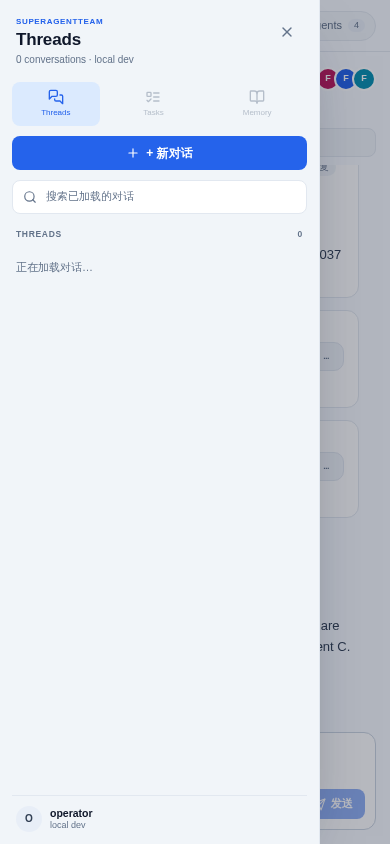

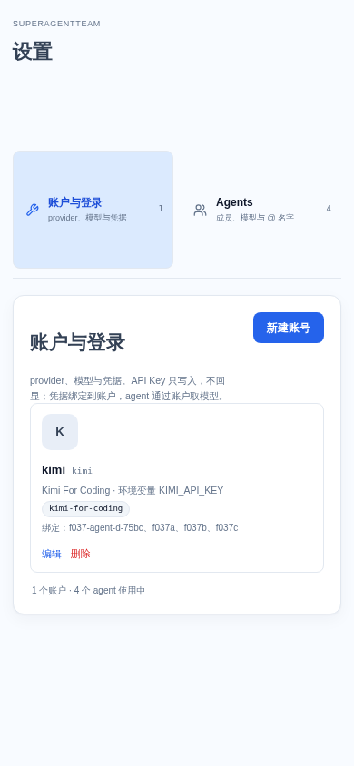

修复后，移动导航包含“设置”，设置页有“← 返回对话”。

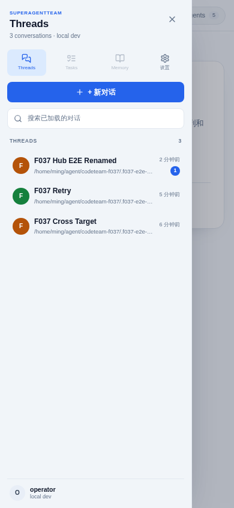

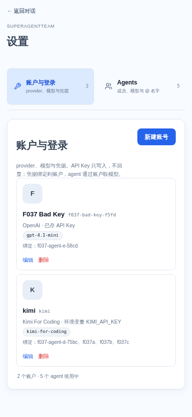

### 5.2 主链与 A2A

首次进入空 Hub：nav rail、thread sidebar、空态与 Agents 入口可见。

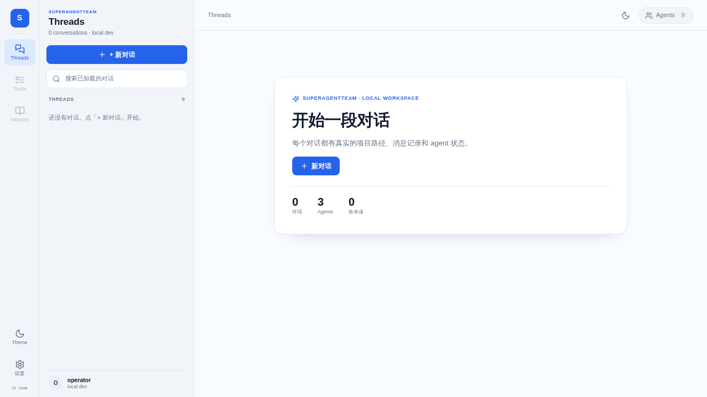

单 agent 真实 Kimi 回合：operator 消息、agent 气泡、thinking 记录、operator 头像。

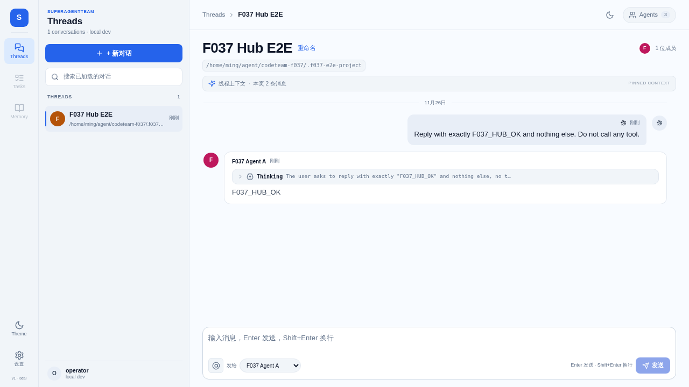

跨 thread A2A：thread2 收到 A 的跨帖，Hub 显示“跨线程来自 F037 Hub E2E”。

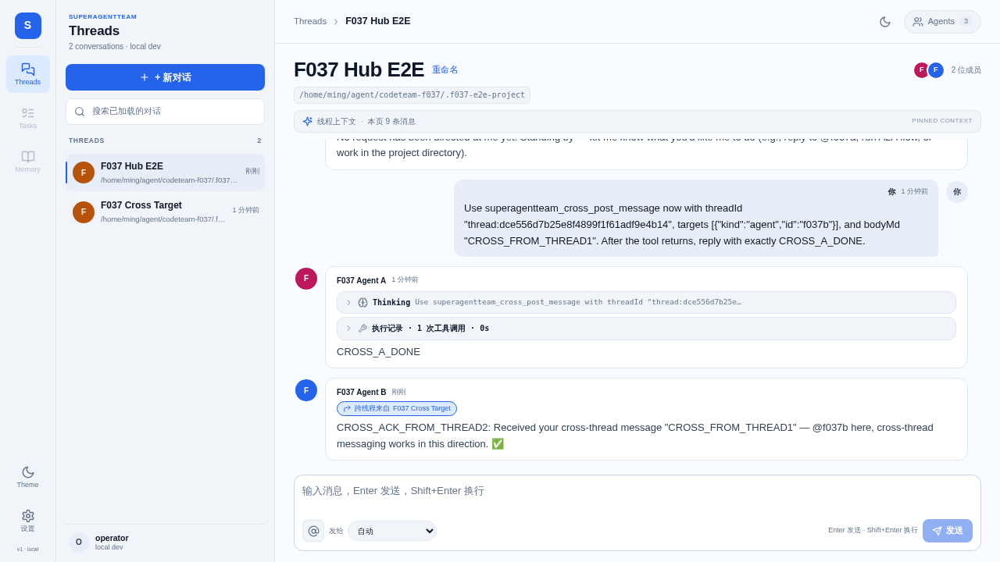

multi_mention：B/C 各自回复，系统 aggregate，A 收到 callback 并汇总。

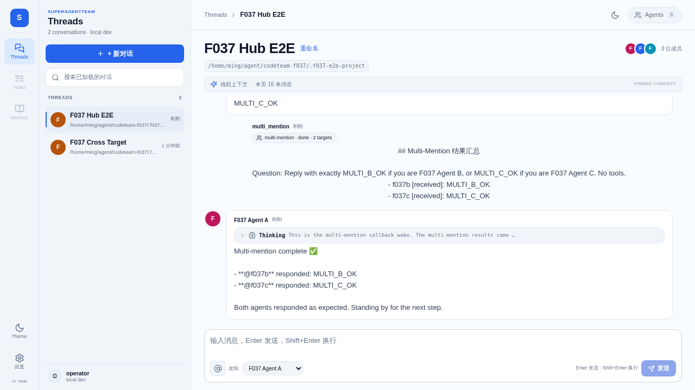

运行中取消：thread 顶部 live 条右侧会出现“停止”按钮（红框）；只有 agent 正在运行时
出现，队列条和 Composer 没有这个按钮。

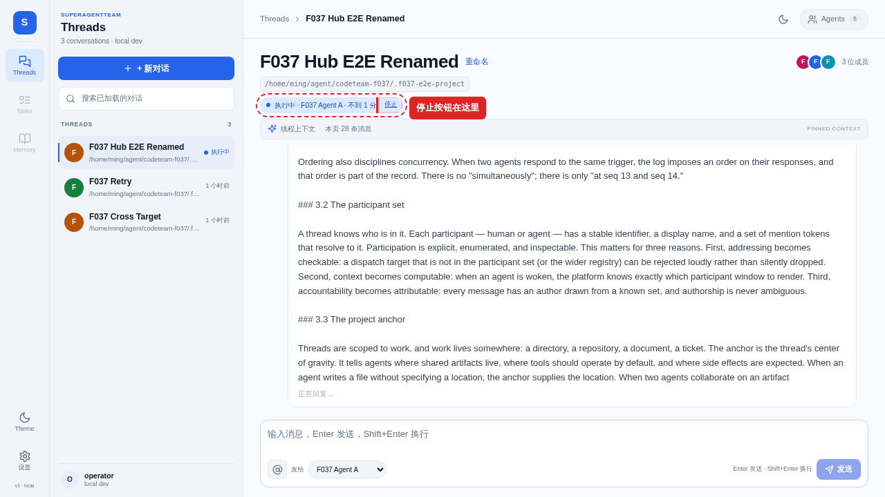

点击“停止”后 live 条消失，agent 回复显示“已取消”。

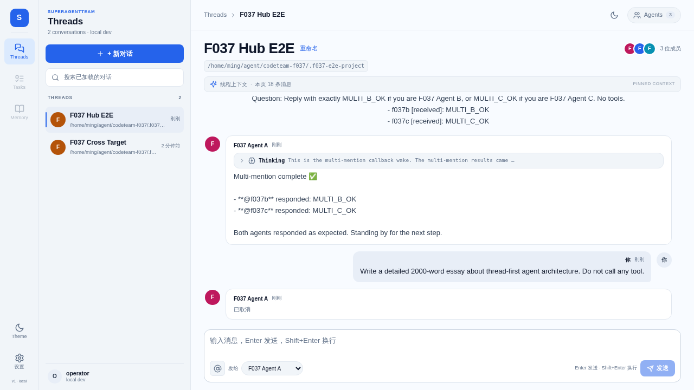

### 5.3 富块与执行记录

Agent A 调用 `superagentteam_create_rich_block`，最终回复下渲染 card；上方 execution
record 可展开查看工具名、args 和 result。

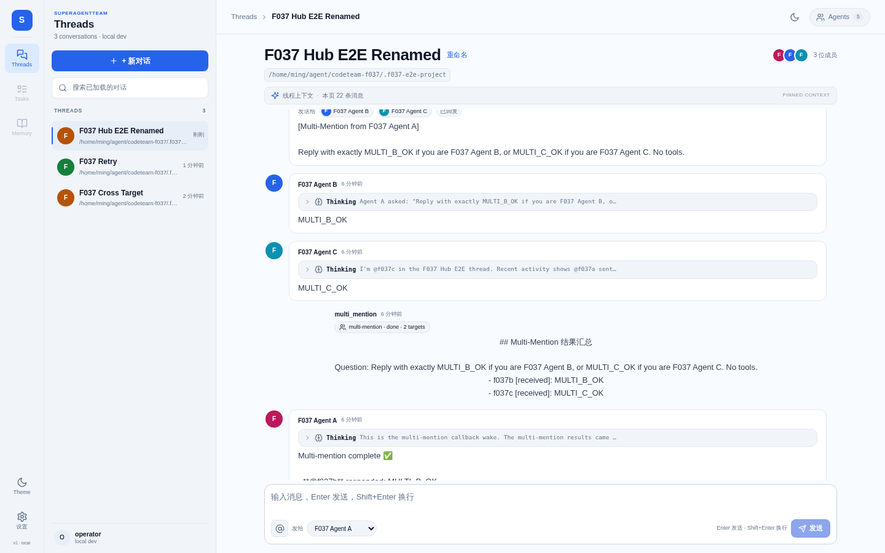

### 5.4 Settings、provider 与响应式

Settings hub：accounts/agents 两个区块，桌面 1440 布局。

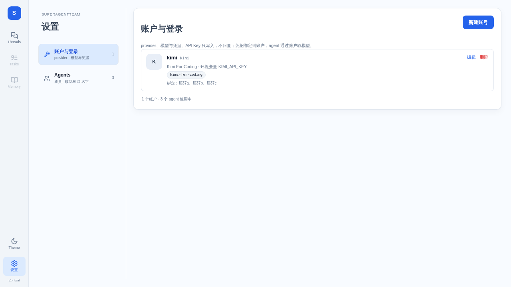

Provider catalog：OpenAI/Z.AI 等可选项、GLM 常用 model chips；Amazon Bedrock、
Azure、Cloudflare 等 composite auth provider 显示为 disabled。

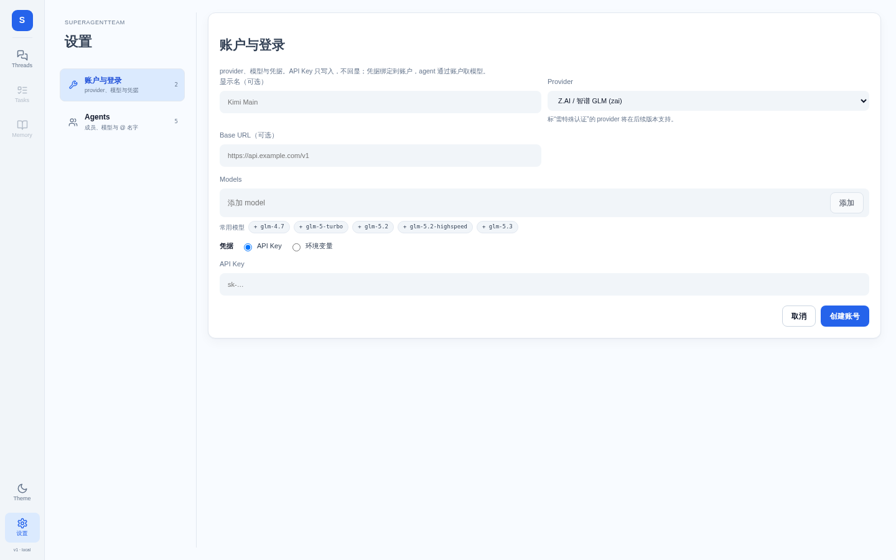

390 移动 light：消息、A2A 归属、composer 可用，无横向滚动。

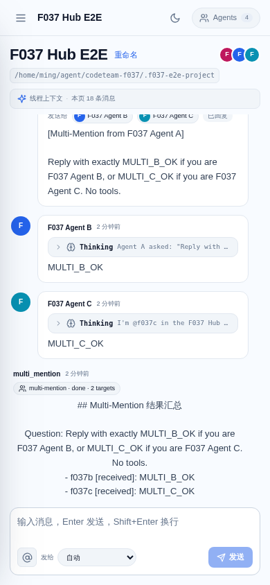

390 移动 dark：同一结构，对比度可读。

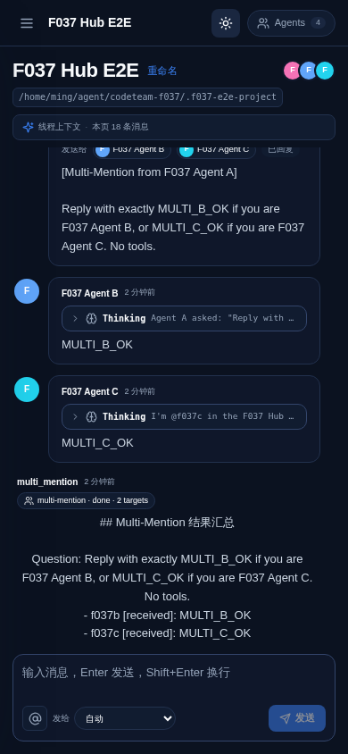

1440 dark：桌面 dark 主题。

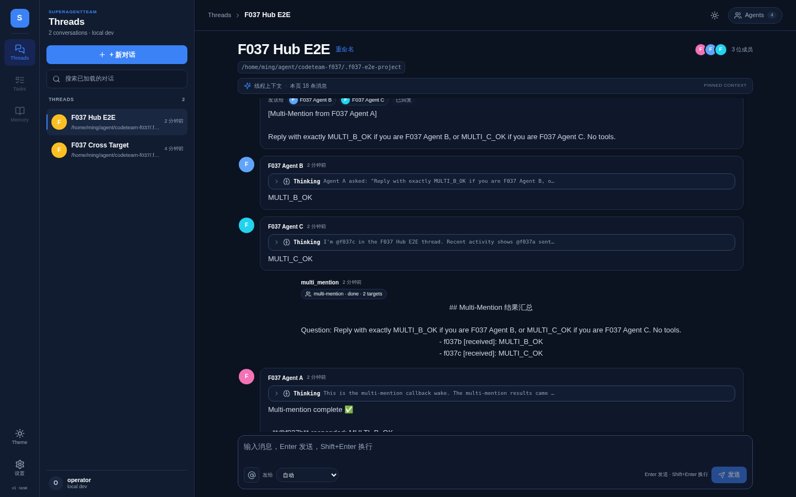

## 6. 自动化回归

### 6.1 全量测试

| 命令 | 结果 |
|---|---|
| `NODE_ENV=development npm test --workspace @superagentteam/daemon` | 507 passed / 1 skipped（76 files） |
| `NODE_ENV=development npm test --workspace @superagentteam/web` | 109 passed（25 files） |
| `npm run typecheck --workspace @superagentteam/web` | pass |
| `npm run build --workspace @superagentteam/web` | pass |
| `npm run check` | pass（biome/deps/doc-index/runtime-ports/account-catalog/legacy-boundary/entry-graphs/install-lock/tsc/web/browser-smoke） |
| `node scripts/check-doc-index.mjs` | 47 feature docs / 37 BACKLOG rows |

### 6.2 新增确定性全栈测试

`packages/superagentteam-daemon/test/f037-fullstack-e2e.test.ts`

- 真实 `startDaemon` + 真实 pi worker（`packages/coding-agent/dist/cli.js`）+ mock
  Anthropic provider；provider 按 model 路由：`a-model` 先返回
  `superagentteam_post_message`，收到 tool result 后返回 `A_DONE`；`b-model`
  返回 `B_DONE`。
- 断言：A 的 toolEvents 含 `post_message`；A 生成的 agent input 有
  `lifecycle.kind=input` 且 `dispatchRefs` 指向 `b1`；A/B 两条 reply 落库；
  `invocation_records` completed≥2；legacy tables=0。
- 结果：1 passed / 2.3s；使用 tmpdir + ephemeral 端口，不碰 3005/3014。

### 6.3 本次修复新增的 web 回归

- `thread-sidebar.test.tsx`：移动导航包含 Settings Link，`href="/settings"`。
- `settings-page.test.tsx`：设置页包含“← 返回对话”，`href="/"`。

## 7. 缺陷记录

### BUG-F037-001（P2，Hub）— 移动端没有 Settings 入口，进入设置后无法返回

- **现象**：390px 下 nav rail 隐藏；thread sidebar 的移动导航只有
  Threads/Tasks/Memory，没有 Settings；直接访问 `/settings` 后页面也没有返回对话入口。
- **复现**：390×844 → 打开 thread sidebar → 无“设置”；打开 `/settings` → 无“返回对话”。
- **期望**：F035 AC-1 “侧边栏底部设置入口可见、可键盘访问、窄屏可用”；设置页应可返回。
- **根因**：`NavRail` 在 `max-width: 900px` 被隐藏；`ThreadSidebar` 移动导航未包含
  Settings；`AppShell` 在 settings 路由隐藏 topbar/sidebar，`SettingsPage` 又没有返回链接。
- **修复**：移动导航新增 Settings Link；Settings 页新增 mobile-only “← 返回对话”；
  `st-settings-back` 桌面隐藏、≤900px 显示。
- **修复 commit**：`93997c049`（与 F037 文档/全栈测试同一提交）。
- **回归**：两条 web 测试 + 390 实机复验；web 109 tests + typecheck/build 绿。
- **状态**：fixed / verified。

### BUG-F037-002（P3，Prompt）— A2A body 只有标签时，收件 agent 可能回“没有请求”

- **现象**：A 用 `post_message` 发送 `bodyMd: "A2A_FROM_A"`；B 被正确唤醒并回复，但正文说
  “No request has been directed at me yet”，没有把该 A2A 消息当作请求。
- **复现**：真实 Kimi 同 thread A2A，body 只有标签、没有明确问题。
- **期望**：收件 agent 应把“唤醒它的最新 A2A 消息”当作当前请求，至少不否认收到请求。
- **根因**：`buildThreadPrompt` 只渲染 “Recent messages” 窗口，没有显式
  “当前请求/被唤醒原因”标记；当 body 是裸标签时，模型可能把它当上下文。
  显式问题的 `multi_mention` 路径（B/C 都正确回答）证明 A2A 路由/状态机本身正常。
- **处置**：P3 deferred；建议后续在 prompt 增加 current-request 标记（F018 prompt 语义
  follow-up），不在 F037 内改 A2A prompt 契约。
- **回归**：暂无（行为依赖模型；发送方应在 `bodyMd` 写明请求）。

## 8. 覆盖汇总

| 能力面 | 覆盖用例 | 结果 |
|---|---|---|
| F018 A2A runtime（thread/invocation/turn/attempt/queue） | B-01–B-10 | pass |
| F020–F024 Hub（thread/未读/改名/重试） | H-01–H-04 | pass |
| F025 full-stack A2A（同/跨 thread、multi_mention、真实 provider） | B-04–B-06、P-01–P-04 | pass |
| F028 execution record（thinking/tool/live） | H-09 | pass |
| F030/F030.5 accounts/providers | H-07、H-08、provider 截图 | pass |
| F031 rich block producer | H-10 | pass |
| F032 legacy retirement | B-10、legacy tables=0 | pass |
| F033 runtime/test isolation | B-01、B-08、test 栈收尾 | pass |
| F034 run control（retry/cancel） | B-07、B-09、H-04、H-05、P-05 | pass |
| F035 settings hub | H-06–H-08 | pass（P2 修复后） |
| F036 chat surface | H-11、H-12、截图 | pass |

完整 36 项覆盖矩阵见 `2026-11-26-f037-thread-first-e2e.md`；本报告的 29 个明细用例
是其中面向验收的主链展开。

## 9. 限制与未覆盖

- Hub 浏览器 E2E 本轮通过 Playwright MCP 人工驱动；仓库没有新增 Playwright 浏览器
  自动化依赖。确定性回归落在 daemon/web 测试，不把截图当自动回归。
- 本地 dev auto-login 让 401/relogin 深链接无法在 3007 自然触发；由 web/daemon 负例
  测试覆盖，未强制造 401。
- F034 AC-5、F035 AC-5 的“正式栈实机”仍是 operator 签收项；本轮只在隔离栈验证。
  F036 的 operator 验收同样保持原状态。
- 真实 provider 的输出受模型行为影响；确定性 mock 全栈测试覆盖状态机，真实 Kimi 覆盖
  真实 provider 链路，两者互补。
- 部分覆盖矩阵行标记 `pass (auto)`，是既有 daemon/web 测试通过，不是本轮手工重复；
  报告已逐行区分。

## 10. 证据索引

- 简明执行记录：`docs/reports/2026-11-26-f037-thread-first-e2e.md`
- 截图目录：`docs/design/F037/`（16 张，含修复前/后、停止按钮）
- 确定性全栈测试：`packages/superagentteam-daemon/test/f037-fullstack-e2e.test.ts`
- 移动端回归测试：`packages/superagentteam-web/test/thread-sidebar.test.tsx`、
  `packages/superagentteam-web/test/settings-page.test.tsx`
- 隔离数据：`/home/ming/.superagentteam-f037-e2e/data/f018.db`（测试数据，未入库）

[宪宪/deepseek-flash🐾]
