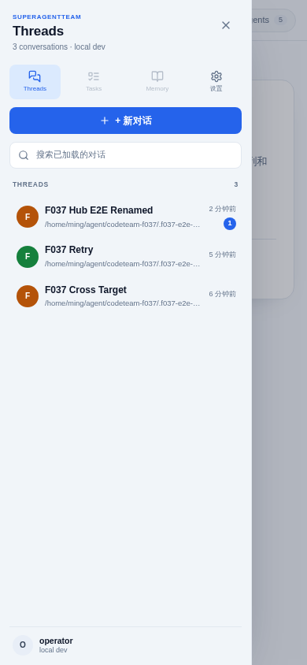
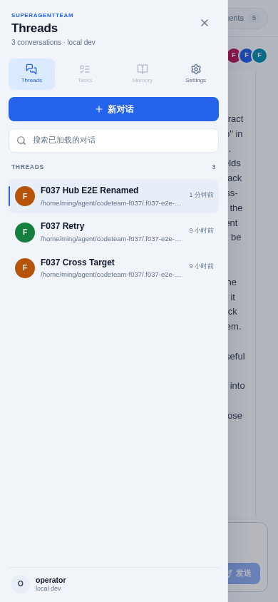
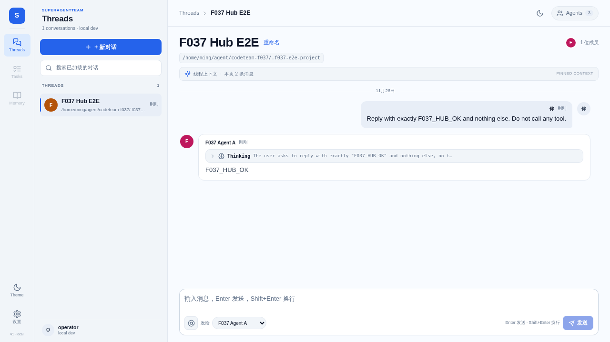
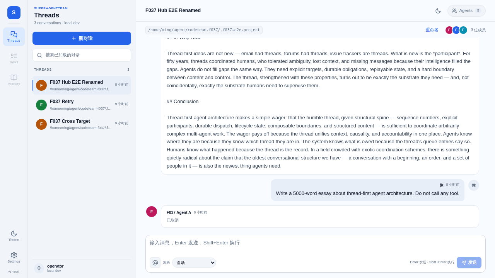
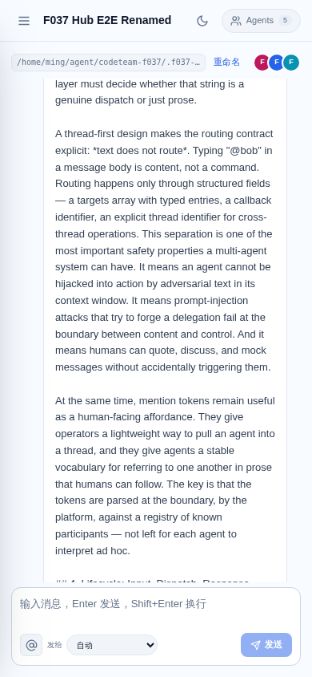
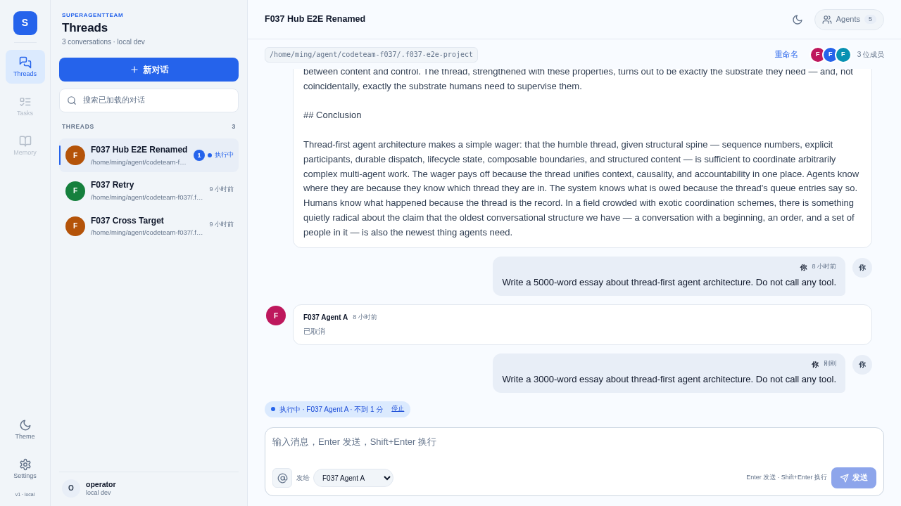
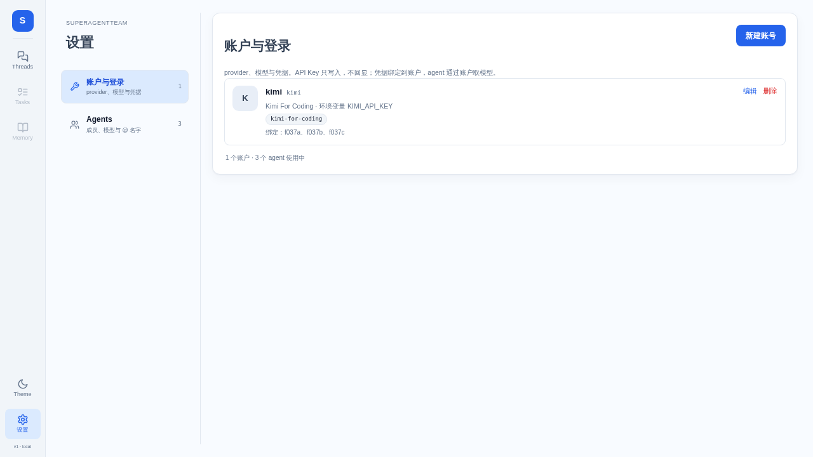
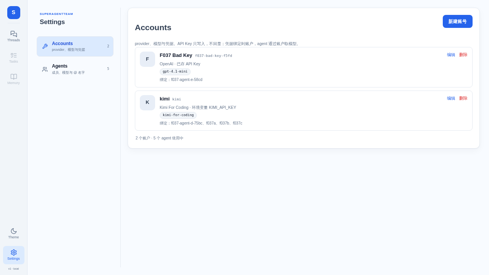
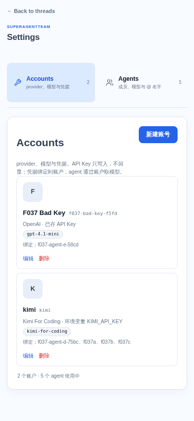

# F038 Hub UI acceptance polish

## 结论

operator 的 4 点 UI 反馈全部落地，A2A/queue/cancel/rename 语义未改：

**收口**：PR #215 landed `e3700094b28cd6b09e97a971f11b20e7b640d039`；reviewed HEAD
`3f3f36c9a`；墨墨非作者 approve；CI 5/5。F038 进入 `superagentteam-work`，
operator 验收 pending。

| # | 反馈 | 结果 |
|---|---|---|
| 1 | 新建对话有两个 `+` | 保留 plus icon，文字改为 `新对话`；空态文案同步 |
| 2 | thread 页 `Threads >` / 重复标题 / 无作用 context 条 | topbar 只留 thread 名；内容区不再重复 h1；移除 thread context 条 |
| 3 | 停止按钮在页面顶部不好找 | LivePill（含“停止”）移到 Composer 正上方；队列条之后、输入框之前 |
| 4 | 左侧“设置”中文、Settings 头部不统一 | NavRail/移动导航改 `Settings`；Settings 页标题 `Settings`；Accounts/Agents 英文；头部 eyebrow/title 与 Threads 对齐 |

## 1. 新建对话 plus 去重

**Before**：侧栏按钮同时有 plus icon 和文字 `+ 新对话`，视觉上两个加号。

**After**：只保留 plus icon，文字为 `新对话`；空态文案为“点「新对话」开始”。

## 2. Thread 页头部

**Before**：topbar 是 `Threads > F037 Hub E2E`；内容区又有一个大标题；下方还有
`线程上下文 · 本页 N 条消息 · pinned context` 条。

**After**：topbar 只显示 thread 名；内容区从项目路径/成员/重命名开始；无重复标题、
无 context 条。

390 下同样只保留 topbar 标题与紧凑 meta；无横向滚动。

说明：被移除的 `线程上下文` 条原本只显示“本页 N 条消息”和一个不可交互的
`pinned context` 占位，没有操作能力；保留只会增加噪音。

## 3. 停止按钮位置

**After**：agent 运行时，`执行中 · F037 Agent A · 不到 1 分` 与“停止”出现在输入框上方；
点击后 live 清空、消息显示“已取消”。

位置确认：停止按钮 `bottom=592.25`，Composer `top=619`，在同一列且位于输入框之前。

## 4. Settings 导航与头部

**Before**：NavRail 是“设置”；Settings 页标题“设置”，tab 是“账户与登录”；
eyebrow 颜色/字号与 Threads 头部不一致。

**After**：NavRail/移动导航 `Settings`；页面标题 `Settings`；tab/panel 为 `Accounts` /
`Agents`；eyebrow 与 Threads 一样使用 primary/8px/600，标题使用同一套 display/17px/600。

390 下同样一致，且有 `← Back to threads` 返回入口。

## 验证

| 命令 | 结果 |
|---|---|
| `NODE_ENV=development npm test --workspace @superagentteam/web` | 110 passed（25 files） |
| `npm run typecheck --workspace @superagentteam/web` | pass |
| `NODE_ENV=development npm run build --workspace @superagentteam/web` | pass |
| `NODE_ENV=development npm run check` | pass（biome/deps/doc-index/ports/catalog/legacy/entry/tsc/web/browser-smoke） |
| 1440/390 视觉 | 无横向滚动；topbar/header/stop/settings 截图 |

## 边界

- 未改 A2A/queue/cancel API、状态机或持久化。
- 未改重命名行为；只把入口从大标题旁移到项目路径行。
- 未做全局 i18n；只统一顶层导航与 Settings 主标签。
- 正式栈 3005/3014 未操作；验证在隔离 3007/3016。

[宪宪/deepseek-flash🐾]
