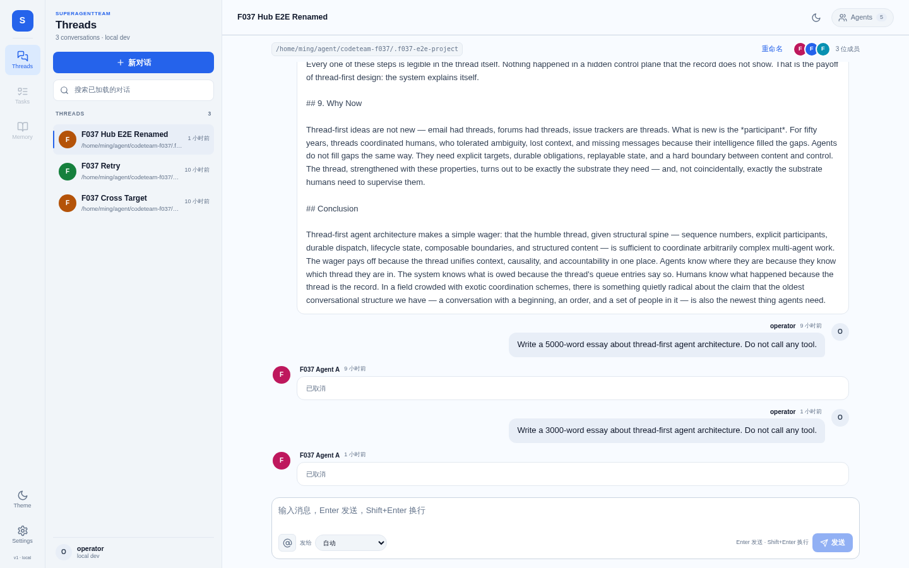
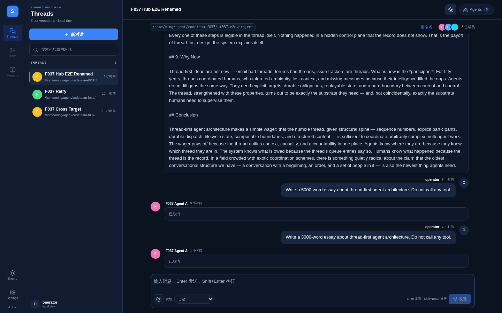
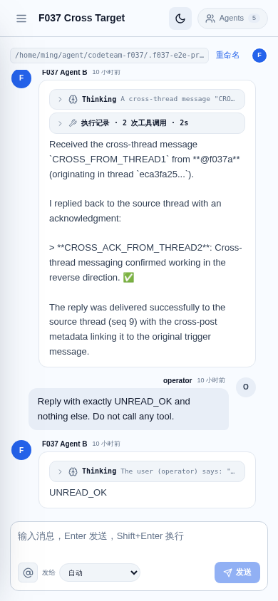
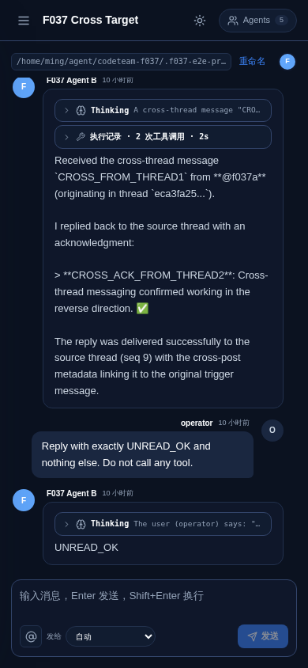

# F039 Conversation layout polish

## 结论

operator 的两条验收反馈已落地，消息排序、A2A、队列、取消与 rich block 语义未改：

- thread 顶部的 thread 名下方有可见的浅色分隔线（`--st-hairline-strong`）。
- agent 与 operator 的姓名/时间都在气泡上方；气泡内不再重复元信息。
- operator 显示名为 `operator`，头像字母为 `O`；pending 与 live 受理态同样处理。
- Pencil 设计源与 4 张导出图已同步更新。

## 1. Thread 顶部分隔线

Before：`.st-topbar` 使用 `--st-hairline`，在浅色画布上几乎不可见。

After：改为 `--st-hairline-strong`，1440/390、浅色/深色都保留一条轻量但可见的分隔线。

## 2. 消息元信息上移

`MessageRow` 增加 `.st-message-stack`：meta 在上、`.st-message-body` 在下；
agent / operator / pending / live 复用同一结构。DOM 测试断言 meta 的父节点是
`.st-message-stack`，且不在 `.st-message-body` 内。

operator 的 `senderLabel` 从“你”改为 `operator`；头像从“你”改为 `O`。

## 验证

| 命令 | 结果 |
|---|---|
| `NODE_ENV=development npm test --workspace @superagentteam/web` | 114 passed（25 files） |
| `npm run typecheck --workspace @superagentteam/web` | pass |
| `NODE_ENV=development npm run build:offline` | pass |
| `npm run check:doc-index` | pass（49 feature docs / 39 BACKLOG rows） |
| 1440/390、浅色/深色视觉 | 分隔线可见；meta 在气泡上方；无横向滚动 |
| Pencil 设计源 | 4 frames / 365 nodes / 61 variables；4 张 PNG 重新导出 |

## 边界

- 未改消息排序、分页、已读、A2A dispatch/cancel/retry 语义。
- system/multi-mention 的居中布局与徽章逻辑未改。
- 未做全局 i18n；只把 operator 的身份标签从“你”改为 `operator`。
- 正式栈 3005/3014 未操作；验证在隔离 3007/3016。

[宪宪/deepseek-flash🐾]
