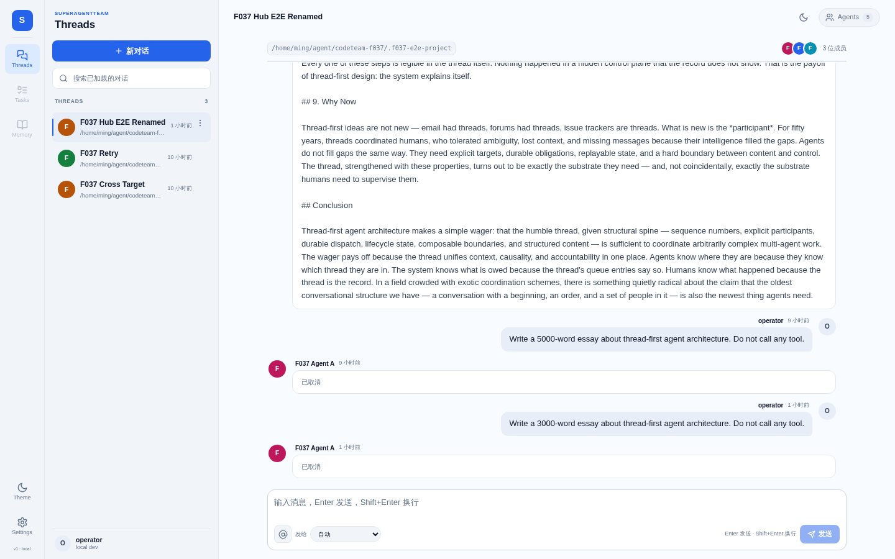
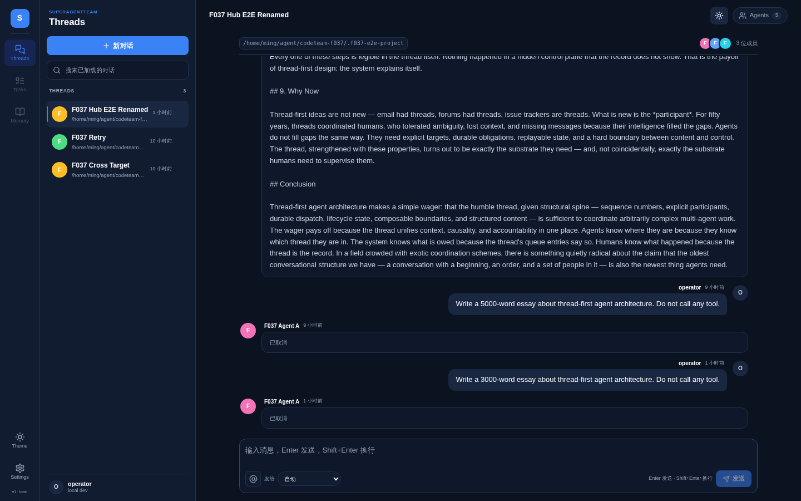
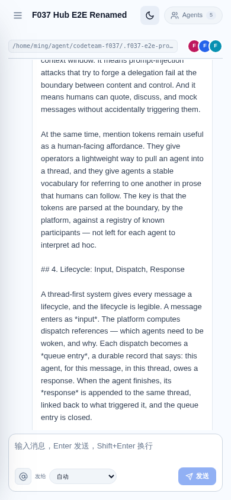
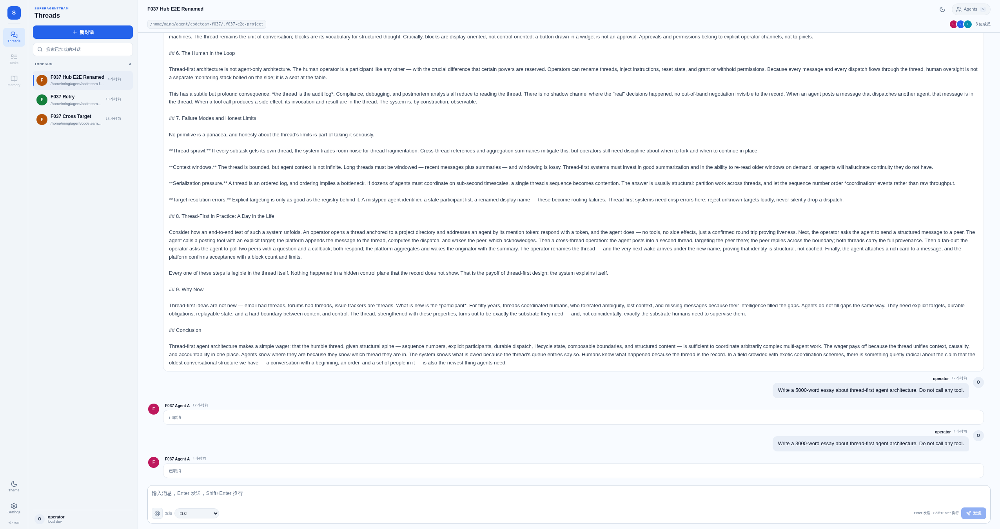
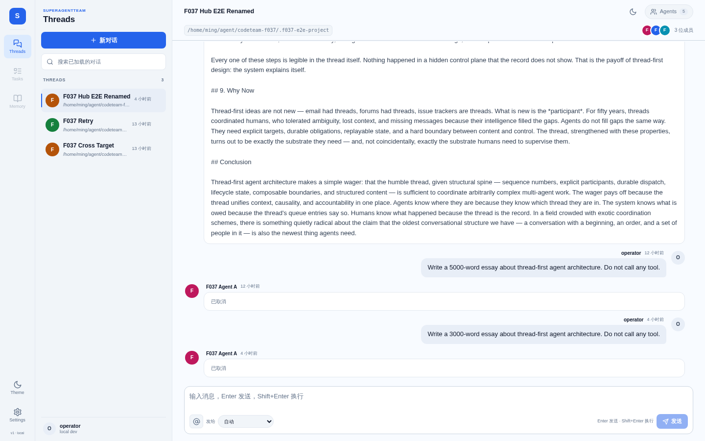
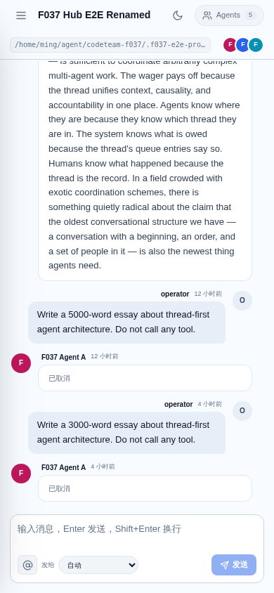

# F040 Thread row actions & header divider

## 结论

operator 的三条后续反馈已落地，消息/A2A/队列/取消语义未改：

1. thread 列表行新增“更多操作”菜单；重命名从 thread 页移入行内编辑。
2. 分隔线从 topbar 下移到项目路径行之后，横向贯通主内容区并连到左侧栏边界；
   thread 标题与项目路径的垂直间距同时收紧。
3. 侧栏标题下的 `N conversations · local dev` 副标题移除。

Pencil 设计源与 4 张导出图已同步。

**收口**：PR #219 merged `5ebfdc56a`；reviewed HEAD `0ad53a592`；墨墨非作者
approve；CI 5/5；web 116 passed；live 3005 deployed runtime head `604dce3ec`。

## 1. Thread 行更多操作

每行右侧有 `更多操作` 按钮；菜单提供 `重命名对话`，点击后标题变为行内输入框。
Enter 保存、Escape 取消；失败在行内显示错误。

390 下更多操作按钮常显，避免 hover-only 交互在触屏不可用：

## 2. Thread 页头部分隔线

`ThreadPage` 移除“重命名”入口；`.st-topbar` 不再画线且高度收到 48/44；项目路径/
成员保留在 `.st-thread-header`。ThreadPage 拆为 head/body 两段，
`.st-thread-divider` 作为全宽兄弟节点横跨主内容区，连到左侧栏边界。

## 3. 侧栏副标题

`ThreadSidebar` 头部只保留 `SUPERAGENTTEAM` eyebrow 与 `Threads` 标题，不再显示
`N conversations · local dev`。

## 4. Post-merge fix — 全宽 thread 内容

operator 在 2551 宽窗口发现标题在左、项目路径/消息列/composer 仍被 980px 居中限宽，
分隔线与内容列不对齐。修复：移除 `.st-thread-page-head` / `.st-thread-page-body`
的 `max-width: 980px`，让标题、项目路径、消息列和 composer 共享主内容区左边缘并使用
全宽；分隔线继续保持全宽。

## 验证

| 命令 | 结果 |
|---|---|
| `npm test --workspace @superagentteam/web` | 116 passed（25 files） |
| `npm run typecheck --workspace @superagentteam/web` | pass |
| `NODE_ENV=development npm run build:offline` | pass |
| `npm run check:doc-index` | pass（50 feature docs / 40 BACKLOG rows） |
| 1440/390、浅色/深色视觉 | 菜单/输入框可用；分隔线在项目路径后；无横向滚动 |
| Pencil 设计源 | 4 frames / 363 nodes / 61 variables；4 张 PNG 重新导出 |

## 边界

- 未新增 thread 删除/归档/收藏等后端能力；菜单只放当前已有的重命名。
- 未改消息、A2A、队列、取消或 rich block 语义。
- 正式栈 3005/3014 未操作；验证在隔离 3007/3016。

[宪宪/deepseek-flash🐾]
