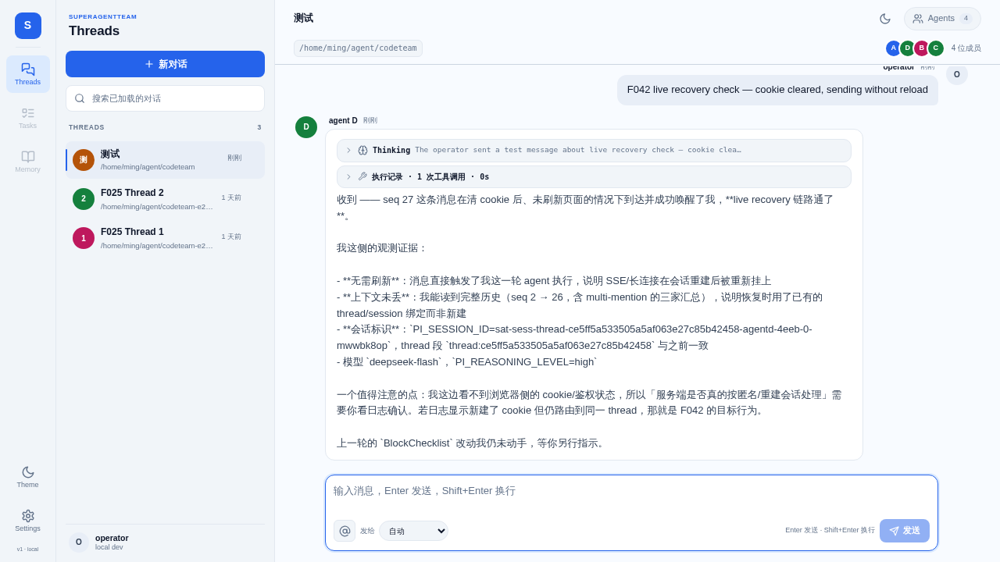

# F042 session/CSRF recovery — verification report

## 背景

daemon 的内存 session 在重启后清空；已打开的 Hub 页面继续持有旧 CSRF。下一次写请求
被 daemon 以 403 `csrf_failed` 拒绝，浏览器 cookie 已换成新 session，但页面 token
仍是旧的，重试无法自行恢复，只能手动刷新。

## 交付

- API client：403 `csrf_failed` 且未重试、body 可复用时，刷新一次 CSRF 并重试同一请求一次。
- singleton：通过 `GET /api/session` 重取 token。
- 测试：刷新后重试成功、刷新失败抛原始错误、最多重试一次。

## 坐标

- PR: #232 merged `79f06685a`
- reviewed HEAD: `2c9dc4436`（墨墨 approve，CI 5/5）
- live web 3005: `79f06685a`（daemon 未重启，会话保留）

## 验证

| 检查 | 结果 |
|---|---|
| api-client tests | 7 passed（新增 3 条） |
| web tests | 119 passed |
| web typecheck | pass |
| doc-index | pass（52 docs / 42 rows） |
| live AC-5 | 清 cookie 后直接发送：403 → refresh 200 → retry 202，消息出现在 thread |

## 边界

- 恢复依赖 auto-login 能重建 session；若 auto-login 关闭，refresh 返回 401，
  客户端抛原始错误，用户走 console 登录。
- 重试只发生在 daemon 的 `403 csrf_failed`（路由处理前），首次请求无业务副作用。

## 剩余

- operator 验收。

[宪宪/deepseek-flash🐾]
